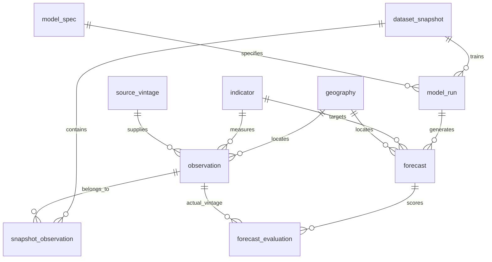

# Data grain and ERD

The application forecasts Philippine national all-items year-on-year inflation, measured in percent. It is a monthly series, not a household, transaction, regional, or commodity-price dataset.

| Table | Exactly one row represents | Business key |
|---|---|---|
| geography | A geographic reporting area | code |
| indicator | An economic series with fixed units, frequency and aggregation | code |
| source_vintage | An immutable uploaded source-file version | SHA-256 |
| observation | One indicator in one geography for one reference month in one source vintage | indicator + geography + month + vintage |
| dataset_snapshot | A frozen analytical dataset and its preparation metadata | snapshot ID |
| snapshot_observation | Membership of one source observation in one snapshot | snapshot + observation |
| model_spec | One fixed model family, order, seasonal order, features and lag specification | model ID |
| model_run | One model fitted to one snapshot at one forecast origin in one experiment phase | model + snapshot + origin + phase |
| forecast | One model-run estimate for one target indicator, geography, and target month | run + indicator + geography + target month |
| forecast_evaluation | One forecast scored against one specified actual-observation vintage | forecast + actual observation |

The executable schema is in `database/schema.sql`. SQLite is the working local prototype store; the proposal's MySQL deployment is future work. The schema is normalized: the monthly wide CSV is an analytical view, not the storage grain. MAE/RMSE are aggregates of evaluation errors grouped by model, phase and horizon; do not average already-aggregated RMSE values.

## Time and provenance rules

- Reference month is the period being measured; `available_at` is the date users could first know the value. Ingestion time is a separate timestamp. Never substitute one for another.
- Original releases/vintages were not supplied. `available_at` stays NULL and availability is marked unknown. File hashes identify supplied vintages, not historical publication dates.
- Historical evaluation is retrospective with assumed predictor delays, not a verified real-time backtest. Revisions may remain embedded in the supplied series.
- Target month must equal forecast origin plus horizon months. This is enforced by the loader and tested, alongside FK constraints. Training ends at the origin; no later inflation enters that run.
- Use a five-month target-relative predictor lag: a three-month-ahead forecast uses indicator observations from at most origin minus two months. This avoids future predictor inputs under the stated delay assumption.
- Source records are not overwritten when revised data arrive: insert a new source vintage and new observations. Snapshots retain their observation IDs.
- Inflation is already year-on-year percent: do not compute percent change again. PHP/USD is the monthly average, policy rate is the last recorded decision in the month carried forward, and M3 is the DCS level in million PHP. M3 growth is derived as 100*(M3[t]/M3[t-12]-1), not stored as another raw observation.
- No interpolation of inflation or M3; the primary experiment is January 2010–July 2026. Unemployment is absent. The legacy `ms.xls` spans December 1986–December 2005, outside the primary sample, and is retained as an archive without merging it into the facts.
- Policy extraction uses the first policy-rate clause in each decision. Five 2011 hold decisions have no numeric rate and are retained for review; carry-forward preserves the preceding numeric decision. The policy-regime change in 2016 and precise effective dates require research review.

## Validation design

Last 24 reference months are a final test block. Twelve prior target months form a validation block. Every horizon uses the same target months across models; each origin uses only observations up to that origin. Model selection uses validation RMSE averaged over the three horizons. Test results are reported after the winner is fixed. Expanding fits within the test block may use already-observed earlier test months, but do not tune the selected specification. Fit failures and nonconvergence disqualify candidates from selection rather than being replaced by favorable fallback estimates.

The prototype performs a small, explicitly bounded model comparison. It does not establish causal effects, complete the paper's full predictor stability study, or claim official forecast accuracy.
